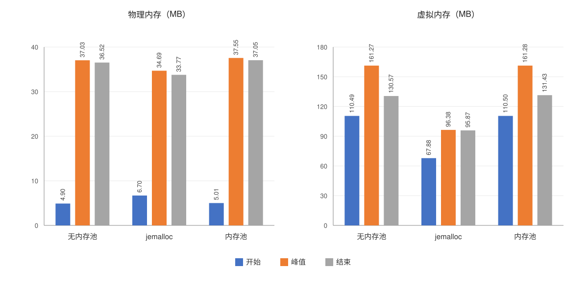

# kvstore

一个基于 RESP 协议、支持四种内存存储引擎、主从复制与 RDB/AOF 持久化的 KV 服务端项目。

## 功能特性

- **网络后端**：reactor(epoll)、proactor(io_uring)、NtyCo 协程三种实现全部编入同一个二进制，
  运行时通过配置文件或 `--network` 选择，切换后端不需要重新编译。
- **存储引擎**：array、rbtree、hash、skiptable，各自一套 `SET/GET/DEL/MOD/EXIST` 风格命令。
- **内存分配**：业务代码统一走 `kvs_malloc` / `kvs_calloc` / `kvs_free`，由编译期宏
  `ENABLE_MEMORYPOOL` 决定使用内置 slab 内存池还是系统 `malloc` / `free`。
- **协议**：外层 4 字节长度前缀帧 + 内层 RESP 数组/批量字符串，支持半包与粘包。
- **持久化**：RDB 全量快照或 AOF 增量日志二选一；启用后启动时自动恢复，RDB/AOF
  不支持同时开启。
- **复制**：`SYNC` 驱动的全量同步（`.tmp` 快照经独立 `rdma-client` / `rdma-server` 搬运）
  + 增量同步（独立 `ebpf-agent` 采集与转发）。详见
  [docs/replication-redesign.md](docs/replication-redesign.md)。

## 目录结构

```text
.
├── CMakeLists.txt          # 构建配置：服务端与测试客户端一起构建
├── kvstore.cpp             # 入口、RESP 解析、命令分发
├── kvstore.conf            # 默认配置文件
├── include/                # 公共头文件与编译期开关
├── config/                 # 配置文件解析
├── network/                # reactor / proactor / ntyco 三种网络后端
├── storage/                # array / rbtree / hash / skiptable
├── memorypool/             # 内置 slab 内存池
├── persistence/            # snapshot（RDB）与 aof
├── replication/            # 复制控制流、采集环、agent 侧采集、RDMA 搬运
├── tools/                  # 独立进程：rdma-client / rdma-server / ebpf-agent
├── testcase/               # 测试客户端源码、测试方案与一键脚本
├── data/                   # 运行时持久化文件目录
├── docs/                   # 内存对比图表、主从同步重设计文档
├── NtyCo/                  # Git submodule，第三方协程库
└── readme.md
```

## 编译与运行

### 1. 依赖

必需：

- CMake 3.10+、C/C++ 编译器、pthread
- liburing（构建期必需）
- OpenSSL `libcrypto`（SHA-256 完整性校验，构建期和运行期必需）
- NtyCo（通过 Git submodule 接入）

可选：

- jemalloc：CMake 默认未强制链接；关闭内存池（`ENABLE_MEMORYPOOL=0`）时可作为系统分配器。
- libibverbs / librdmacm：能找到时额外构建 `rdma-client` / `rdma-server` 两个独立进程承担
  全量搬运；`kvstore` 自身不链接 RDMA 库。

Ubuntu/Debian 安装依赖：

```bash
sudo apt-get update
sudo apt-get install -y build-essential cmake liburing-dev libssl-dev libjemalloc-dev
```

### 2. 获取源码与 NtyCo 子模块

首次克隆：

```bash
git clone --recurse-submodules <repo-url>
```

已有仓库：

```bash
git submodule sync --recursive
git submodule update --init --recursive

# 或执行一键脚本，效果相同，可重复执行
./setup_submodule.sh
```

NtyCo 源码会随 `kvstore` 一起编译，不依赖 submodule 内生成的 `libntyco.a`，因此不需要手工
在 `NtyCo/` 下执行 `make`。如果 `NTYCO_ROOT` 指向的目录里没有 `core/nty_coroutine.h`，
CMake 会在配置阶段直接报错并提示先初始化子模块。

### 3. 编译步骤

```bash
cd /path/to/kvstore
git submodule sync --recursive
git submodule update --init --recursive
cmake -S . -B build
cmake --build build -j$(nproc)
```

编译产物：

- 服务端：`build/kvstore`
- 测试客户端：`build/testcase/{AOF,RDB,integrity,test,master-replica,memorypool}/...`

需要自定义 NtyCo 路径时：

```bash
cmake -S . -B build -DNTYCO_ROOT=/path/to/NtyCo
```

> 历史文档中出现过的 `-DURING_ROOT` 未在 `CMakeLists.txt` 中定义，请改用 `-DNTYCO_ROOT`。

### 4. 运行

> 持久化路径在代码中是 `../data/kvstore.data` 和 `../data/append.aof`（相对进程工作目录），
> 因此必须从 `build/` 目录启动服务，否则会写到错误的位置。

启动参数只接受命名开关，不再支持旧的位置参数形式：

```bash
cd build

# Master，监听 9999
./kvstore --port 9999 --role master

# Replica，监听 10001，连接 Master 的 9999
./kvstore --port 10001 --role replica \
  --master-ip 127.0.0.1 --master-port 9999
```

配置文件形式：默认依次尝试 `./kvstore.conf` 与 `../kvstore.conf`，也可用 `--config <path>`
显式指定。

```bash
cd build
./kvstore --config ../kvstore.conf
```

`kvstore.conf` 核心字段：

- `bind` / `port`：监听地址与端口。
- `log_level`：`debug`、`info`、`warn`、`error` 或 `off`。
- `role`：`master` 或 `replica`（也接受 `slave`、`0`、`1`）。
- `master_ip` / `master_port`：角色为 `replica` 时连接的主节点地址与端口。
- `persistence_mode`：`none`、`rdb` 或 `aof`，RDB 与 AOF 互斥；也可用
  `rdb on/off`、`aof on/off` 分别控制，但不能同时开启。默认为 `none`。
- `network_architecture`：`reactor`（或 `epoll`）、`ntyco`（或 `coroutine`）、
  `proactor`（或 `io_uring`），默认 `ntyco`；启动时确定，运行期间不能切换。

命令行开关可以覆盖配置文件中的值：

```bash
./kvstore --config ../kvstore.conf --port 7000 --role replica \
  --master-ip 127.0.0.1 --master-port 9999 --persistence-mode aof \
  --network reactor
```

只想临时切换一次网络后端时，可以不改配置文件：

```bash
./kvstore --network reactor
./kvstore --network ntyco
./kvstore --network proactor
```

## 测试方案与可行性

### 测试环境

- 单机验证：服务从 `build/` 目录启动，测试客户端连接 `127.0.0.1`。
- 协议：外层 4 字节长度前缀帧 + 内层 RESP 负载，客户端实现见 `testcase/testcase.h`。
- 前置条件：已完成编译，`build/kvstore` 与对应 `build/testcase/...` 客户端存在，
  `data/` 目录可写。
- 持久化用例依赖 io_uring（RDB/AOF 均通过 io_uring 读写文件）；容器或受限沙箱若禁用了
  `io_uring_setup`，会表现为 `AOF init failed` 或写快照失败，需要在支持 io_uring 的环境运行。

### 测试用例与结果

| 用例 | 测试代码 | 执行方式 | 验证点 | 结果 |
| --- | --- | --- | --- | --- |
| AOF 增量恢复 | `testcase/AOF/{save,load}.cpp` | `testcase/run_aof_cycle.sh` | `AOF CLEAR` 后写入 10 万条，重启服务时自动恢复后数据完整 | 已通过 |
| RDB 全量恢复 | `testcase/RDB/{save,load}.cpp` | `testcase/run_rdb_cycle.sh` | 写入 10 万条 → `RDB SAVE` → 重启服务时自动恢复后数据完整 | 已通过 |
| 持久化完整性校验 | `testcase/integrity/*` | `testcase/run_persistence_integrity.sh` | 快照/AOF 改字节、截断、删除、重排和旧格式均拒绝启动且保留文件 | 已通过 |
| 主从全量同步（重设计阶段 1+2） | `testcase/master-replica/*.cpp` | `testcase/run_sync_fullsync.sh` | Master 写入 10 万条 → `SYNC` → `rdma-server`/`rdma-client` 搬运 → 逐条比对一致 | 已通过 |
| 主从全量+增量（重设计阶段 3） | `testcase/master-replica/*.cpp` | `testcase/run_sync_increment.sh` | 前 5 万全量、后 5 万由独立 `ebpf-agent` 缓存/转发 → Replica 10 万条一致 | 已通过 |
| 三网络后端协议回归（重设计阶段 4） | 内嵌 python 校验 | `testcase/run_backends_check.sh` | reactor / ntyco / proactor 四引擎命令与异常响应一致 | 已通过 |
| 同步异常路径回归（重设计阶段 5） | 内嵌 python 校验 | `testcase/run_sync_faults.sh` | 未武装拒绝 / 缓存溢出重同步 / rdma-client 失败重试 三条异常均按预期恢复 | 已通过 |
| 主从全量 + 增量同步 | `testcase/master-replica/*.cpp` | 手动分步执行（见下） | 先写 5 万条启动 Replica 做全量同步，再写 5 万条走增量，Replica 读到 10 万条 | 已通过 |
| 单引擎命令回归 | `testcase/test/testcase.cpp` | `build/testcase/test/test 127.0.0.1 9999 <mode>` | 四引擎 `SET/GET/DEL/MOD/EXIST` 及异常响应 | 可扩展执行 |
| 内存池对比 | `testcase/memorypool/*.cpp` | `memptest` / `memptest_pthread` + `monitor_mem.sh` | 内存占用与并发稳定性 | 已采集，见「性能数据」 |

### 一键执行持久化用例

```bash
cd /path/to/kvstore

# AOF：写入 10 万条 -> 重启服务自动恢复 -> 校验
./testcase/run_aof_cycle.sh

# RDB：写入 10 万条 -> RDB SAVE -> 重启服务自动恢复 -> 校验
./testcase/run_rdb_cycle.sh

# 主从全量同步（重设计阶段 1+2）：Master 写入 10 万条 -> SYNC -> RDMA 搬运 -> 逐条比对
./testcase/run_sync_fullsync.sh

# 主从全量+增量（重设计阶段 3）：额外的 5 万条由独立 ebpf-agent 缓存/转发 -> 逐条比对
./testcase/run_sync_increment.sh

# 三个网络后端（reactor / ntyco / proactor）的协议级回归
./testcase/run_backends_check.sh

# 同步异常路径回归（未武装拒绝 / 缓存溢出重同步 / rdma-client 失败重试）
./testcase/run_sync_faults.sh
```

这些脚本都会自动从 `build/` 启动所需进程（Master / Replica / `ebpf-agent`，同步用例还会
拉起 `rdma-client` / `rdma-server`）、等待就绪、跑客户端断言，并用 SIGINT 优雅停服。
输出 `... completed.` 表示用例通过；断言失败会以非零状态码退出。

### 主从同步用例（手动）

重设计后 eBPF 是**强制依赖**：Master 只在 `ebpf-agent` 注册后才受理 `SYNC`，因此手动跑
必须先把 agent 起来。下面是最小步骤（采集用 `sim` 模式，免 capability；用 uprobe 模式则需
先按 [setup_ebpf.sh](setup_ebpf.sh) 给 `build/ebpf-agent` 授权限）：

```bash
cd build

# 0. 准备：kvstore.conf 里配好 rdma_port、replica_host（必须是 RDMA 网卡 IP，
#    不能是 127.0.0.1）、ebpf_capture_mode sim；RDMA 链路用 setup_rdma.sh 准备。

# 1. 先起采集进程（未注册时 Master 会拒绝 SYNC）
./ebpf-agent --mode sim --ring ../data/kvstore.ebpf.ring \
    --master 127.0.0.1:9999 --replica 127.0.0.1:10001 &

# 2. 启动 Master，并写入前 5 万条
./kvstore --port 9999 --role master &
./testcase/master-replica/insert_before5w 127.0.0.1 9999

# 3. 另开终端启动 Replica，触发 SYNC 全量同步（快照经 rdma-client/rdma-server 搬运）
./kvstore --port 10001 --role replica \
    --master-ip 127.0.0.1 --master-port 9999 &

# 4. 向 Master 写入后 5 万条，由 agent 走 REPL_INC 增量通道转发
./testcase/master-replica/insert_after5w 127.0.0.1 9999

# 5. 在 Replica 上校验 10 万条（前 5 万全量 + 后 5 万增量）
./testcase/master-replica/get10w 127.0.0.1 10001
```

等价的一键脚本是 `./testcase/run_sync_increment.sh`（阶段 3 全链路）。
每 5 万条按四种引擎均分（`SET`/`RSET`/`HSET`/`SSET` 各 12500 条），`get10w` 会逐条比对，
失败时打印 `==> FAILED ...`。

### 单引擎命令回归（可选）

```bash
cd build
# mode：0 rbtree，1 array，2 hash，3 skiptable
./testcase/test/test 127.0.0.1 9999 1
```

### 可行性结论与已知局限

可行性：

- 持久化与主从同步用例已在单机环境验证通过，可通过上述一键脚本复现（含三后端协议回归与
  同步异常路径注入）。
- 用例只依赖编译产物；`build/` 下的 `kvstore`、`rdma-client`、`rdma-server`、`ebpf-agent`
  与测试客户端由同一次 CMake 构建生成。主从同步用例需要可用的 RDMA（SoftiWARP 即可）。

已知局限：

- 目前均为单机功能正确性验证（10 万数据量级），不构成压力/稳定性测试。
- 未覆盖真实多机部署与网络分区；异常路径已覆盖未武装拒绝、缓存溢出、rdma-client 失败重试
  三类（`run_sync_faults.sh`），但未覆盖磁盘满、内存不足等资源类故障。
- 采集的 `uprobe` 模式未做进程级端到端验证：本次环境无法给 `ebpf-agent` 设置 file
  capability，验证全部走 `sim` 模式；建议在有 root 的机器上复验一次。
- 大流量增量受既有引擎性能限制：`kvs_array_set` 为线性扫描（插入 O(n²)），5 万条 `SET`
  回放约 15s，而 `RSET` 仅约 1.6s。
- 当前仅支持单从机；`rdma-client` 的健康检查是被动的（靠 Replica 等待失败/超时触发重试）。
- RDB 记录长度依赖 `strlen`，不支持嵌入 NUL 的 key/value，也不支持跨主机字节序移植。
- AOF 批量落盘，进程被强制杀死时可能丢失未达刷新阈值的缓冲数据。

## 性能数据

> 目前只有内存占用实测数据，吞吐、延迟等指标待补充。

### 内存占用（实测）

比较无内存池、jemalloc 和内置内存池三种配置在开始、峰值、结束时的内存占用，单位为 MB。
左图为物理内存，右图为虚拟内存；每组柱子顺序为「开始 / 峰值 / 结束」。两图数据量级不同，
各自使用独立纵轴，柱高不可跨图直接比较。



| 配置 | 物理内存（开始 / 峰值 / 结束） | 虚拟内存（开始 / 峰值 / 结束） |
| --- | ---: | ---: |
| 无内存池 | 4.90 / 37.03 / 36.52 | 110.49 / 161.27 / 130.57 |
| jemalloc | 6.70 / 34.69 / 33.77 | 67.88 / 96.38 / 95.87 |
| 内存池 | 5.01 / 37.55 / 37.05 | 110.50 / 161.28 / 131.43 |

数据由 `monitor_mem.sh` 采样 RSS/VmSize 得到，图表由 `docs/gen_memory_chart.py` 生成：

```bash
./monitor_mem.sh --duration 30 --output /tmp/kvstore_mem.csv 9999 0
python3 docs/gen_memory_chart.py
```

## 通信协议与命令

服务端采用两层协议，客户接入时务必保持一致：

1. 外层是长度前缀帧：4 字节网络字节序无符号长度，后跟该长度的负载。
2. 内层负载是 RESP 数组/批量字符串格式，例如：

```text
*3\r\n
$3\r\nSET\r\n
$3\r\nkey\r\n
$5\r\nvalue\r\n
```

请求和响应都使用同样的帧格式；一次负载可包含多条命令（粘包），三个网络后端都实现了半包处理。
消息体上限 `MAX_ALLOWED_LEN` 为 1MB，超限会被拒绝或断开连接。

命令表见 `kvstore.cpp` 的 `command[]` 与 `enum KVS_CMD`：

- array：`SET GET DEL MOD EXIST`
- rbtree：`RSET RGET RDEL RMOD REXIST`
- hash：`HSET HGET HDEL HMOD HEXIST`
- skiptable：`SSET SGET SDEL SMOD SEXIST`
- 持久化：`RDB SAVE`、`AOF CLEAR`；恢复只在服务启动时自动执行
- 主从全量同步（重设计阶段 1）：`SYNC`、`SYNC FINISHED`（由服务端之间使用，详见
  [docs/replication-redesign.md](docs/replication-redesign.md)）

> `RDB SAVE` 等带空格的命令是一个整体 token，不是两个参数。

响应约定：

- 写成功 `+OK\r\n`，键已存在 `+EXIST\r\n`，错误 `-ERROR\r\n`。
- `GET` 成功返回批量字符串；键不存在返回 `$8\r\nNO EXIST\r\n`。
- `DEL` / `MOD` 不存在返回 `$8\r\nNO EXIST\r\n`。
- `EXIST` 存在返回 `$5\r\nEXIST\r\n`，不存在返回 `$8\r\nNO EXIST\r\n`。

## 主从复制与同步

重设计后复制被拆成「kvstore 控制流 + 独立进程」：全量搬运交给 `rdma-client` /
`rdma-server`，增量采集与转发交给 `ebpf-agent`。设计与阶段记录见
[docs/replication-redesign.md](docs/replication-redesign.md)。

进程与通道：

| 角色 | 可执行文件 | 职责 |
| --- | --- | --- |
| Master | `build/kvstore`（role=0） | 处理 `SYNC` / `SYNC FINISHED`、生成 `.tmp` 快照、启停 `rdma-client` |
| Replica | `build/kvstore`（role=1） | 启停 `rdma-server`、发 `SYNC`、加载 `.tmp`、回放增量 |
| RDMA 客户端 | `build/rdma-client` | 读 `.tmp`，用 RDMA 写给对端 `rdma-server` |
| RDMA 服务端 | `build/rdma-server` | 接收 RDMA 文件并原子落盘，收完退出 |
| eBPF 采集 | `build/ebpf-agent` | 采集写命令与控制记录，缓存/转发增量给 Replica |

关键点：

- **全量**：Replica 发 `SYNC` → Master 把快照写成 `data/kvstore.sync.tmp` 并派生
  `rdma-client` → 文件经 RDMA 到 Replica 侧 `rdma-server`（落在 `<tmp>.recv`）→
  Replica 加载后回 `SYNC FINISHED`，Master 删除 `.tmp` 并回收 `rdma-client`。
- **增量**：`ebpf-agent` 通过 `REPL_INC` 专用握手连 Replica；全量窗口内的写命令由 agent
  缓存，读到 `SYNC FINISHED` 记录后按序补发，之后转实时转发。
- **顺序保证**：写命令与 `SYNC` / `SYNC FINISHED` 都经同一个 uprobe 挂载点
  （`kvs_ebpf_notify_write`）在存储锁内取号，采集流顺序 == 提交顺序，因此
  「缓存窗口 ⊇ 快照窗口」由顺序本身保证，不依赖额外水位。
- **eBPF 强制**：Master 只在 agent 注册（`EBPF` 握手）后才受理 `SYNC`；采集不可用时
  直接回 `-ERROR`，不会静默降级。
- **启动恢复顺序**：持久化数据在网络服务和 Replica 同步线程启动前加载，因此不会引入
  在线重同步窗口。客户端不再提供运行期 `RDB LOAD` / `AOF LOAD` 命令。
- **断连处理**：fd 生命周期归网络层，各后端在断连路径调用
  `kvs_replication_remove_replica()` 清理复制/同步会话登记，避免 fd 复用后旧映射仍生效。
- 存储引擎没有内部锁，所有访问都经过 `kvstore.cpp` 的可重入存储锁。

## RDMA 全量搬运（独立进程）

编译时能找到 libibverbs/librdmacm 会额外构建 `rdma-client` 与 `rdma-server` 两个可执行文件；
**`kvstore` 自身不再链接 RDMA 库**（`ldd build/kvstore` 无 ibverbs/rdmacm 依赖）：

- Master 收到 `SYNC` 后把快照写到固定的 `data/kvstore.sync.tmp`（不可配置），再派生 `rdma-client` 把文件发给
  Replica 侧的 `rdma-server`；后者原子落盘（`.partial` + rename）后退出，Replica 以
  「子进程退出」作为文件就绪信号。
- Replica 在发 `SYNC` 之前先派生 `rdma-server` 并等它创建就绪文件，避免 `rdma-client`
  先到、连接被拒。
- 实时增量不走 RDMA，始终由 `ebpf-agent` 的 TCP 增量通道承载。
- 任一环节失败都会打印明确的失败步骤，例如
  `[RDMA-XFER] send failed at step [rdma_resolve_addr]: errno=22(Invalid argument)`；
  Replica 侧等待文件失败/超时后按退避重试 `SYNC`。

用软件 RDMA 验证：

```bash
sudo ./setup_rdma.sh          # 默认在 ens33 上创建 SoftiWARP 链路 siw1
rdma link show                # 应显示 siw1/1 state ACTIVE
```

注意事项：

- `rdma link add` 创建的 SoftiWARP 链路不持久化，重启后需重新执行 `setup_rdma.sh`。
- **`replica_host` 必须是 RDMA 网卡 IP**（例如 `192.168.234.135`），**不能用 127.0.0.1**：
  RDMA 无法 resolve 回环地址（`rdma_resolve_addr` 返回 EINVAL）。Master 用它作为
  `rdma-client` 的目标地址。
- `rdma_port` 是独立配置项（默认 `10000`），不再沿用旧实现的「数据端口 + 1」——那个端口
  曾被进程内 RDMA 监听占用，容易和 `rdma-server` 冲突。
- 实现使用「普通 `IBV_WR_RDMA_WRITE` + 一条 SEND 通知」，不要改回
  `IBV_WR_RDMA_WRITE_WITH_IMM`：SoftiWARP 下带立即数的写会在 `ibv_post_send` 返回 ENOSPC(28)。
- `siw` 是软件 RDMA（底层仍走 TCP/IP），吞吐不会优于 TCP，主要用于在没有 RDMA 硬件的环境
  跑通代码路径；真实性能收益需要 RoCE 等硬件。

## eBPF 实时增量采集

实时增量由**独立的 `ebpf-agent` 进程**采集与转发（不再在 kvstore 进程内消费）：

```text
Master 写路径 / SYNC / SYNC FINISHED（都在存储锁内）
  -> kvs_ebpf_notify_write(seq, argc, argv)   uprobe 挂载点（kvstore 侧）
       uprobe 模式：函数体不采集，参数由挂在函数入口的 BPF 程序读取并写 ringbuf
       sim   模式：函数体把记录写进共享内存环
  -> ebpf-agent 消费（ringbuf 或共享内存环），校验序号连续性
  -> 状态机：IDLE -> CACHING（读到 SYNC）-> LIVE（读到 SYNC FINISHED）
  -> REPL_INC 增量通道投递给 Replica
```

关键点：

- **两种采集模式**（运行期由 `ebpf_capture_mode` 选择）：
  `uprobe`（默认）由 agent 建 ringbuf、把 uprobe 挂到 **Master 二进制**的
  `kvs_ebpf_notify_write` 符号上（偏移从 ELF `.symtab` 解析）；`sim` 让 Master 写共享内存环、
  agent 读该环，用于无 CAP_BPF 的容器/CI 验证。两条路径对上层完全等价。
- **跨主机可用**：eBPF 只负责本机采集，跨主机投递仍走 TCP，不要求 Master/Replica 同内核。
- **为什么是 uprobe**：kprobe 只能挂内核函数，读不到应用层参数，也会在 proactor(io_uring) 后端
  下漏事件；uprobe 触发在 Master 自身写路径上，三个后端都能采集。
- **顺序即正确性**：写命令与 `SYNC` / `SYNC FINISHED` 走同一条有序流（都在存储锁内取号），
  所以 agent 读到 `SYNC` 一定早于其后发生的任何写命令，「缓存窗口 ⊇ 快照窗口」由顺序保证。
- **丢事件可检测**：ringbuf/环满会丢记录，因此每条记录带自增序号；agent 一旦发现序号缺口就
  断开增量通道，让 Replica 重新全量同步，绝不静默丢命令。缓存溢出同理。
- **不截断命令**：单条命令最多 3 个参数、每个参数最多 `KVS_EBPF_EVENT_ARG_MAX`(1024) 字节。
- **强制依赖**：采集不可用时 agent 直接退出，Master 也只在 agent 注册后才受理 `SYNC`
  （eBPF 强制）。这与旧实现「失败就回退直写 backlog」的行为不同。

### 依赖与内核要求

- 仅支持 Linux x86_64；直接调用 `bpf(2)`，不依赖 libbpf/clang/bpftool，也不需要 bpffs。
- 需要内核支持 `BPF_MAP_TYPE_RINGBUF`（Linux 5.8+）及 `bpf_probe_read_user_str` 等 helper。
- 需要 `CAP_BPF`（或 `CAP_SYS_ADMIN`）、`CAP_PERFMON`（或 `CAP_SYS_ADMIN`）；写 tracefs 的
  `uprobe_events` 需要 root 权限（内核提供 uprobe PMU 时不需要 tracefs）。

### 运行前配置与验证

```bash
# 检查内核版本、uprobe/tracefs、perf_event_paranoid、capability
./setup_ebpf.sh --check

# 给采集进程加 capability（或直接用 root 运行）
sudo setcap cap_bpf,cap_perfmon,cap_sys_admin+ep ./build/ebpf-agent
```

> 注意授权对象是 **`build/ebpf-agent`**（BPF 代码都在 agent 里），不是 `build/kvstore`。
> **每次 `cmake --build` 之后都要重新执行 `./setup_ebpf.sh`**：内核会在文件被写入时清除
> `security.capability`，此时 agent 会打印
> `create ringbuf map failed ... Operation not permitted` 并直接退出。

采集通道生效时，agent 启动日志会出现：

```text
[EBPF] uprobe attached via perf PMU: /path/to/kvstore:0x...
[EBPF] uprobe capture active: /path/to/kvstore:0x... pid=<master pid>
[EBPF-AGENT] registered with master 127.0.0.1:9999
```

不具备 eBPF 能力时（容器/CI）改用 sim 模式即可跑通整条链路，无需特殊构建：

```bash
# kvstore.conf
ebpf_capture_mode sim
ebpf_ring_file ../data/kvstore.ebpf.ring

# 启动时 agent 传 --mode sim --ring ../data/kvstore.ebpf.ring
```

sim 模式的记录格式与内核 ringbuf 完全一致（同一条消费代码），启动日志会显示
`[EBPF] sim capture active: shared ring ...`。

### 常见故障排查

| 现象 | 常见原因 | 处理方式 |
| --- | --- | --- |
| agent 启动即退出：`create ringbuf map failed` EPERM | 缺少 `CAP_BPF`/`CAP_SYS_ADMIN`，或重新编译后 `security.capability` 被内核清除 | 重跑 `./setup_ebpf.sh`（每次 build 后都要），或直接 root 运行 agent |
| agent 启动失败：`symbol kvs_ebpf_notify_write not found` | Master 二进制被 strip，`.symtab` 缺失 | 不要 strip `kvstore`；或用 sim 模式 |
| agent 启动失败：`uprobe 模式需要 --pid 与 --binary` | 启动命令漏参数 | 补 `--pid <master_pid> --binary ./kvstore` |
| `tracefs not writable` / 无 uprobe PMU | 容器未暴露 tracefs 或内核无 uprobe PMU | 改用 `ebpf_capture_mode sim` |
| `perf_event_open failed` EPERM | `perf_event_paranoid` 过高或缺 `CAP_PERFMON` | 调整 `kernel.perf_event_paranoid` 或补 capability |
| Replica 日志 `master rejected SYNC: -ERROR` | eBPF 强制：agent 未注册（或已掉线） | 先启动 agent 并确认 `registered with master` |
| agent 日志 `capture stream lost N event(s)` / `cache overflow` | 采集环满或缓存超限 | 已自动断开增量通道触发重同步；频繁出现可调大 `KVS_EBPF_RINGBUF_SIZE` / `--cache-max-*` |
| Master 重启后 agent 退出码 3 | uprobe 绑在旧进程上，无法自动重挂 | 用新的 `--pid` 重启 agent；sim 模式会自动重开环 |

## 数据持久化与恢复

服务启动时会按 `persistence_mode` 自动加载持久化数据；文件不存在时以空数据集启动，
文件存在但读取失败时启动失败。RDB 与 AOF 只能择一开启。持久化路径在代码中写死为
`../data/kvstore.data`（RDB）和 `../data/append.aof`（AOF），所以必须从 `build/` 目录启动。

### RDB 全量恢复

- `RDB SAVE`：把四种存储引擎的当前状态序列化为全量快照 `data/kvstore.data`。
- 快照格式为 `KVSDB02`、版本 2，文件末尾追加 32 字节 SHA-256，覆盖文件头、区块和全部记录。
- 启动自动恢复：在 RDB 模式下读取并加载 `data/kvstore.data`。运行期不提供外部
  `RDB LOAD` 命令。
- 加载时先校验长度和 SHA-256，再重置引擎并解析；摘要不匹配、异常截断或解析后仍有未解释字节
  都会拒绝启动，原文件不会被自动截断或改写。

### AOF 增量恢复

- 正常写入时（非 AOF 恢复、非 Replica 重放阶段）会把写命令追加到 `data/append.aof`。
- AOF 以 `#KVSAOF02\r\n` 开头；每条 RESP 命令后紧跟 64 位十六进制 SHA-256 和 CRLF。
- 每条摘要使用哈希链 `Hi = SHA256(Hi-1 || uint64 小端命令长度 || RESP 命令字节)`，
  可发现命令内容修改、中间记录删除和重排。
- 启动自动恢复：在 AOF 模式下读取并重放 `append.aof`。运行期不提供外部
  `AOF LOAD` 命令。
- `AOF CLEAR`：刷新缓冲、清空日志并写入新的 `#KVSAOF02` 文件头。
- AOF 采用批量落盘，进程被强杀时最多丢失未达刷新阈值的内存缓冲数据；优雅关闭或执行
  `AOF CLEAR` 会先刷新缓冲区。
- 现有 `KVSDB01` 快照和无文件头的旧 AOF 不再兼容，服务会明确拒绝启动；本项目不提供旧格式
  迁移工具，需要清空旧文件或从业务数据重建。
- SHA-256 未使用密钥，能发现误写、截断和普通手工篡改；掌握文件格式的人仍可重新计算摘要并
  伪造文件。如果需要抵抗有主动伪造能力的攻击者，应改用带外部密钥的 HMAC 方案。

### 常见排查提示

- 找不到持久化文件：确认进程工作目录是 `build/`。
- 日志出现 `Snapshot integrity check failed` 或 `AOF integrity check failed`：文件可能被修改、
  截断或未完整落盘；服务会保留现场并拒绝启动，排查后再从可信数据恢复。
- 升级后提示 `Unsupported snapshot/AOF format`：这是升级前的旧格式；当前版本不兼容旧文件。
- 服务启动自动恢复时段错误：快照格式、`kvs_reset_data()` 或存储引擎 destroy 逻辑可能有问题；
  修改这些代码后至少执行一次 `RDB SAVE` + 重启自动恢复回归。

## 常见问题

**构建时提示 NtyCo 缺失**

```bash
git submodule sync --recursive
git submodule update --init --recursive
```

报 `nty_coroutine.h: No such file or directory` 说明子模块未初始化；按上述命令同步即可。

**找不到 liburing / jemalloc**

```bash
sudo apt-get install -y liburing-dev libjemalloc-dev
```

liburing 是构建期必需依赖。内存分配由 `memorypool/memorypool.h` 的 `ENABLE_MEMORYPOOL` 决定：
置 `1` 时 `kvs_malloc` / `kvs_calloc` / `kvs_free` 走内置 slab 内存池，置 `0` 时走系统
`malloc` / `calloc` / `free`；若构建时链接了 jemalloc，置 `0` 实际使用的是 jemalloc。

**需要指定依赖或 NtyCo 目录**

```bash
cmake -S . -B build -DNTYCO_ROOT=/path/to/NtyCo
```

**连接成功但响应异常**

先确认客户端是否按「4 字节长度头 + RESP 负载」收发，而不是直接发送裸 RESP；帧封装可参考
`testcase/testcase.h`。
